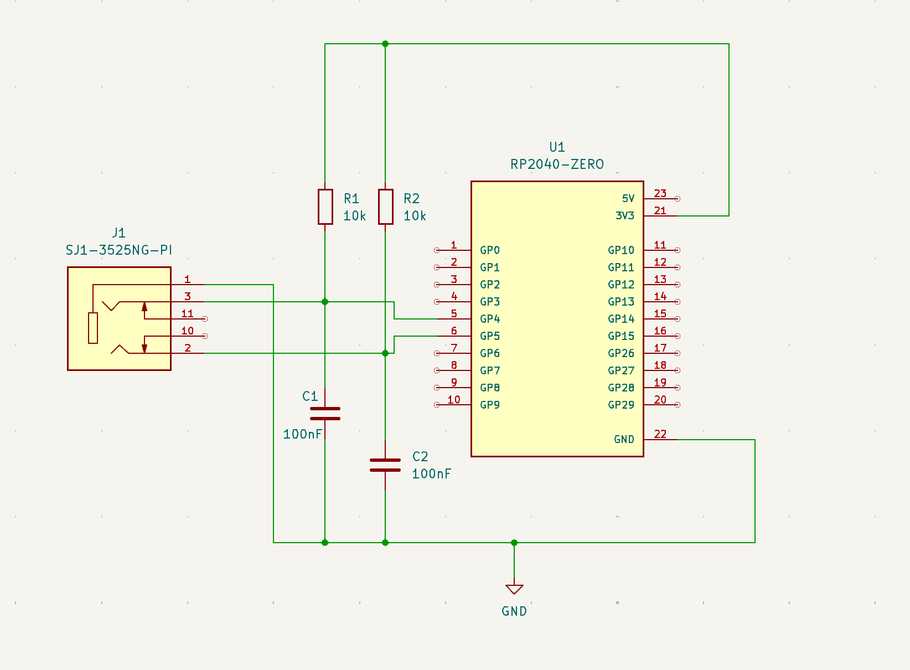

# MorseOSLAB Interface

[Polski](#polski) · [English](#english) · [Deutsch](#deutsch)

## Polski

Użyj płytki RP2040 z wyprowadzonymi **GPIO 4 i GPIO 5**, portem USB z transmisją danych i trybem **BOOTSEL**. Do Raspberry Pi Pico użyj dołączonego obrazu. Dla innej płytki wybierz przeznaczony dla niej obraz CircuitPython i sprawdź nazwy pinów w kodzie.

Moduł pozwala podłączyć fizyczny klucz telegraficzny do iPhone’a z aplikacją MorseOSLAB na iOS. Dzięki temu możesz ćwiczyć nadawanie alfabetem Morse’a na własnym kluczu, korzystając z ćwiczeń i dekodowania w aplikacji.

Mam dostępne płytki PCB do tego projektu. Jeśli wolisz wykonać moduł samodzielnie, w repozytorium znajdziesz schemat, pliki produkcyjne i gotowe oprogramowanie. Przy przygotowanych elementach sam montaż zajmuje kilka minut, a koszt modułu jest niewielki.

## Zawartość repozytorium

| Plik | Zawartość |
| --- | --- |
| [MorseOSLAB-sch_V1.png](MorseOSLAB-sch_V1.png) | Schemat połączeń interfejsu w wersji V1. |
| [MorseOSLAB-board-V1.png](MorseOSLAB-board-V1.png) | Podgląd projektu płytki PCB. |
| [MorseOSLAB_GERBERS_V1.zip](MorseOSLAB_GERBERS_V1.zip) | Pliki Gerber i pliki wierceń potrzebne do zamówienia płytki. |
| [circuitpython-pico-10.3.1.uf2](circuitpython-pico-10.3.1.uf2) | Obraz CircuitPython 10.3.1 dla Raspberry Pi Pico. |
| [boot.py](boot.py) | Konfiguracja interfejsu USB. |
| [code.py](code.py) | Program odczytujący styki klucza i wysyłający zdarzenia MIDI. |
| [modul.jpg](modul.jpg), [modul_b.jpg](modul_b.jpg) | Zdjęcia zmontowanego modułu. |
| [Diy.jpg](Diy.jpg), [Diy2.jpg](Diy2.jpg) | Zdjęcia przykładowego wykonania DIY. |

## Montaż i uruchomienie

1. Przygotuj elementy i połącz je zgodnie ze schematem. Jeśli zamawiasz PCB, użyj plików produkcyjnych z archiwum ZIP.
2. Podłącz RP2040 do komputera przewodem USB, trzymając przycisk **BOOTSEL**. Skopiuj plik `circuitpython-pico-10.3.1.uf2` na dysk **RPI-RP2**. Płytka uruchomi się ponownie.
3. Po ponownym uruchomieniu otwórz dysk **CIRCUITPY**, skopiuj `boot.py` i `code.py` do jego głównego katalogu, bezpiecznie wysuń dysk i odłącz oraz podłącz płytkę ponownie.
4. Podłącz klucz do modułu, a moduł przewodem USB z transmisją danych do iPhone’a z MorseOSLAB. W aplikacji wybierz interfejs w **Settings → General → Key input** i uruchom ćwiczenie **Free keying**, żeby sprawdzić nadawanie.

### Inny mikrokontroler jako źródło MIDI

Możesz użyć innego mikrokontrolera, który zgłasza się do iPhone’a jako standardowe urządzenie **USB MIDI 1.0**. Wysyłaj komunikaty na **kanale 1**. W dostarczonym `code.py` **GP5 → nuta 69 (A4)**, a **GP4 → nuta 70 (A♯4/B♭4)**. Przy zwarciu styku do GND wyślij raz **Note On** z velocity **100**, a po zwolnieniu **Note Off** z velocity **0**. Aplikacja akceptuje też Note On z velocity 0 jako zwolnienie. Obsługuj oba styki niezależnie i eliminuj drgania styków. Wybierz urządzenie w **Settings → General → Key input**. Możesz dopasować numery nut dla obsługiwanego wejścia, jeśli aplikacja udostępnia dla niego ustawienia nut.

## English

Use an RP2040 board with exposed **GPIO 4 and GPIO 5**, a USB data port and **BOOTSEL** mode. Use the included image for Raspberry Pi Pico. For another board, use its matching CircuitPython image and check the pin names in the code.

This interface connects a physical Morse key to an iPhone running the MorseOSLAB app for iOS. Use your own key to practise sending Morse code and see what the app decodes.

You can build the interface yourself at low cost using the schematic, manufacturing files and ready-to-flash firmware in this repository. Once you have the parts ready, assembly takes just a few minutes.

| File | Contents |
| --- | --- |
| [MorseOSLAB-sch_V1.png](MorseOSLAB-sch_V1.png) | V1 wiring schematic. |
| [MorseOSLAB-board-V1.png](MorseOSLAB-board-V1.png) | Preview of the PCB layout. |
| [MorseOSLAB_GERBERS_V1.zip](MorseOSLAB_GERBERS_V1.zip) | Gerber and drill files for PCB fabrication. |
| [circuitpython-pico-10.3.1.uf2](circuitpython-pico-10.3.1.uf2) | CircuitPython 10.3.1 image for Raspberry Pi Pico. |
| [boot.py](boot.py) | USB interface configuration. |
| [code.py](code.py) | Reads the key contacts and sends MIDI events. |
| [modul.jpg](modul.jpg), [modul_b.jpg](modul_b.jpg) | Photos of the assembled module. |
| [Diy.jpg](Diy.jpg), [Diy2.jpg](Diy2.jpg) | Photos of an example DIY build. |

### Assembly and setup

1. Gather the parts and connect them as shown in the schematic. If ordering a PCB, use the manufacturing files from the ZIP archive.
2. Hold **BOOTSEL** while connecting the RP2040 to your computer over USB. Copy `circuitpython-pico-10.3.1.uf2` to the **RPI-RP2** drive. The board will restart.
3. After the restart, open **CIRCUITPY**, copy `boot.py` and `code.py` to its root, safely eject the drive, then unplug and reconnect the board.
4. Connect the Morse key to the module, then connect the module to your iPhone with a USB data cable. Select the interface in **Settings → General → Key input** and open **Free keying** to test sending.

### Using another microcontroller as a MIDI source

You can use another microcontroller that presents itself to the iPhone as a standard **USB MIDI 1.0** device. Send messages on **channel 1**. In the supplied `code.py`, **GP5 → note 69 (A4)** and **GP4 → note 70 (A♯4/B♭4)**. When a contact closes to GND, send one **Note On** with velocity **100**. On release, send **Note Off** with velocity **0**. The app also accepts a velocity-zero Note On as a release. Debounce each contact and handle both independently. Select the device under **Settings → General → Key input**. You can adjust note numbers for compatible inputs when the app shows note settings.

## Deutsch

Verwende eine RP2040-Platine mit zugänglichen **GPIO 4 und GPIO 5**, einem USB-Datenanschluss und **BOOTSEL**-Modus. Für den Raspberry Pi Pico kannst du das beiliegende Image verwenden. Wähle für andere Platinen das passende CircuitPython-Image und prüfe die Pinnamen im Code.

Mit diesem Interface kannst du eine Morsetaste an ein iPhone mit der iOS-App MorseOSLAB anschließen. Damit kannst du das Geben von Morsezeichen mit deiner eigenen Taste üben und sehen, welche Zeichen die App dekodiert.

Du kannst das Interface mit geringem Kostenaufwand selbst bauen. Schaltplan, Fertigungsdateien und die fertige Firmware findest du in diesem Repository. Wenn alle Bauteile bereitliegen, dauert der Zusammenbau nur wenige Minuten.

| Datei | Inhalt |
| --- | --- |
| [MorseOSLAB-sch_V1.png](MorseOSLAB-sch_V1.png) | Schaltplan des Interfaces in Version V1. |
| [MorseOSLAB-board-V1.png](MorseOSLAB-board-V1.png) | Vorschau des Platinenlayouts. |
| [MorseOSLAB_GERBERS_V1.zip](MorseOSLAB_GERBERS_V1.zip) | Gerber- und Bohrdateien für die Platinenfertigung. |
| [circuitpython-pico-10.3.1.uf2](circuitpython-pico-10.3.1.uf2) | CircuitPython 10.3.1 für den Raspberry Pi Pico. |
| [boot.py](boot.py) | Konfiguration der USB-Schnittstelle. |
| [code.py](code.py) | Liest die Tastenkontakte ein und sendet MIDI-Ereignisse. |
| [modul.jpg](modul.jpg), [modul_b.jpg](modul_b.jpg) | Fotos des fertig aufgebauten Moduls. |
| [Diy.jpg](Diy.jpg), [Diy2.jpg](Diy2.jpg) | Fotos eines beispielhaften Selbstbaus. |

### Aufbau und Inbetriebnahme

1. Lege die Bauteile bereit und verbinde sie gemäß dem Schaltplan. Wenn du eine Platine bestellst, verwende die Fertigungsdateien aus dem ZIP-Archiv.
2. Halte **BOOTSEL** gedrückt, während du den RP2040 per USB an den Computer anschließt. Kopiere `circuitpython-pico-10.3.1.uf2` auf das Laufwerk **RPI-RP2**. Die Platine startet anschließend neu.
3. Öffne nach dem Neustart das Laufwerk **CIRCUITPY** und kopiere `boot.py` und `code.py` in dessen Hauptverzeichnis. Wirf das Laufwerk sicher aus und schließe die Platine erneut an.
4. Schließe die Morsetaste an das Modul an und verbinde das Modul per USB-Datenkabel mit deinem iPhone. Wähle das Interface unter **Settings → General → Key input** und teste das Geben in **Free keying**.

### Anderen Mikrocontroller als MIDI-Quelle verwenden

Du kannst einen anderen Mikrocontroller verwenden, der sich beim iPhone als Standardgerät für **USB MIDI 1.0** anmeldet. Sende die Nachrichten auf **Kanal 1**. In der mitgelieferten `code.py` gilt **GP5 → Note 69 (A4)** und **GP4 → Note 70 (A♯4/B♭4)**. Sende beim Schließen eines Kontakts gegen GND einmal **Note On** mit Velocity **100**. Sende beim Loslassen **Note Off** mit Velocity **0**. Die App erkennt auch Note On mit Velocity 0 als Loslassen. Entprelle beide Kontakte und verarbeite sie unabhängig voneinander. Wähle das Gerät unter **Settings → General → Key input**. Bei kompatiblen Eingängen kannst du die Notennummern ändern, wenn die App die entsprechenden Einstellungen anzeigt.
